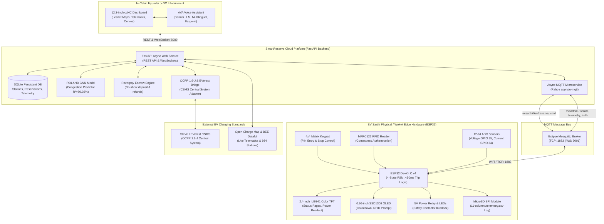

# Hyundai SmartReserve & EV Sarthi IoT Ecosystem

[](https://hcoe-ideathon.com/)
[](https://hcoe-ideathon.com/)
[](https://hcoe-ideathon.com/)
[](https://python.org)
[](https://fastapi.tiangolo.com)
[](https://wokwi.com/projects/480737603461683201)
[](https://mosquitto.org/)
[](https://openchargealliance.org/)
[](https://deepmind.google/technologies/gemini/)
[](file:///c:/Users/kusha/OneDrive/Music/Documents/Projects/EV_Hyundai/tests)

---

## 📌 Executive Overview

**Hyundai SmartReserve** is an enterprise-grade in-cabin EV charging co-pilot for Hyundai's **ccNC / AVNT infotainment system**. It pairs spatio-temporal AI demand prediction with physical and simulated edge IoT charging hardware (**EV Sarthi**), an asynchronous **Eclipse Mosquitto MQTT broker**, a **SteVe / LF Energy EVerest OCPP 1.6-J bridge**, and **AVA**, an intelligent multilingual voice assistant powered by **Google Gemini**.

Drivers can query stations in natural English, Hindi, or Marathi, plan charging stops along high-speed corridors with a 30 km radius search, and lock an exclusive charging slot with a single tap. The reservation physically locks the charger contactor over MQTT/OCPP and issues an encrypted one-time PIN and RFID token for instantaneous authorization.

* **Live Cloud Demo:** [https://hyundai-vrum.onrender.com](https://hyundai-vrum.onrender.com)
* **Live Wokwi Hardware Simulation:** [Wokwi Project 480737603461683201](https://wokwi.com/projects/480737603461683201)
* **2-Page Hardware Engineering Summary:** [EV_Sarthi_Hardware_Summary.pdf](file:///c:/Users/kusha/OneDrive/Music/Documents/Projects/EV_Hyundai/docs/EV_Sarthi_Hardware_Summary.pdf)
* **Architecture Blueprint:** [architecture_horizontal.png](file:///c:/Users/kusha/OneDrive/Music/Documents/Projects/EV_Hyundai/architecture_horizontal.png)

---

## 🏛️ System Architecture



---

## ⚡ EV Sarthi: IoT Hardware & Firmware Architecture

The edge charging station is governed by an **ESP32 DevKit C v4** running low-latency C++ firmware. It was engineered and validated in Wokwi simulation with shared VSPI bus arbitration, dual display drivers, multi-factor authentication, and an empirical safety trip system.

🔗 **Inspect & Run Live in Browser:** [Wokwi Simulation Project 480737603461683201](https://wokwi.com/projects/480737603461683201)

### 1. Hardware Bill of Materials (13 Components)

| Component | Hardware Model | Interface | Pins / GPIOs | Role & Functionality |
|---|---|---|---|---|
| **MCU** | ESP32 DevKit C v4 | Xtensa Dual-Core | 240 MHz, WiFi / BLE | Core FSM, WiFi client, MQTT pub/sub, hardware interlocks |
| **User TFT** | ILI9341 2.4″ Color TFT | Shared SPI (VSPI) | CS: 14, DC: 2, RST: 4 | Real-time state splash, PIN masking, live kW and kWh graph |
| **Diagnostic OLED** | SSD1306 128×64 | I²C Bus | SDA: 21, SCL: 22 | 60s reservation countdown, cable-insertion grant, fault diagnostics |
| **Contactless RFID** | MFRC522 13.56 MHz | Shared SPI (VSPI) | CS: 27, RST: 26 | Contactless RFID tag scanning (`DEADBEEF`), SHA-256 dispatch |
| **Persistent Logger** | MicroSD Module | Shared SPI (VSPI) | CS: 5 | Append-only 11-column session & heartbeat CSV logging |
| **Matrix Keypad** | 4×4 Matrix Keypad | Digital GPIO | Rows: 13,12,16,17 / Cols: 25,32,33 | 4-digit PIN entry (`2580#`), cancel (`*`), emergency stop (`#`) |
| **Current Sensor** | ACS712 (simulated pot.) | 12-bit ADC1 | GPIO 34 (ADC1_CH6) | 0–32A sensing; vehicle plug-in detection (>0.8A) |
| **Voltage Sensor** | Resistor Divider (pot.) | 12-bit ADC1 | GPIO 35 (ADC1_CH7) | 0–250V sensing; line voltage monitoring |
| **Power Relay** | 5V SPDT Contactor Relay | Digital Output | GPIO 15 | Fail-safe: LOW/NC = Red LED (De-energized); HIGH/NO = Green LED |
| **Status LEDs** | Red & Green LEDs | Relay Terminals | NC / NO Terminals | Instant visual feedback on contactor lock state |
| **Shared SPI Bus** | Hardware VSPI | Dedicated Bus | SCK: 18, MISO: 19, MOSI: 23 | Master bus arbitrated by mutual CS pin toggling |

### 2. 4-State Finite State Machine (FSM)

```
       [ Power-On / Reset ]
                 │
                 ▼
          ┌─────────────┐
   ┌─────►│  AVAILABLE  │◄───────────────────┐
   │      └──────┬──────┘                    │
   │             │ MQTT /reserve             │ Timeout / End
   │             ▼                           │
   │      ┌─────────────┐                    │
   │      │  RESERVED   │────────────────────┤
   │      └──────┬──────┘                    │
   │             │ PIN / RFID Validated      │
   │             ▼                           │
   │      ┌─────────────┐                    │
   │      │  CHARGING   │────────────────────┘
   │      └──────┬──────┘
   │             │ Overcurrent / Overvoltage / Cmd Fault
   │             ▼
   │      ┌─────────────┐
   └──────┤   FAULTED   │ (Manual Reset / Backend Clear)
          └─────────────┘
```

* **AVAILABLE (0)**: Contactor open (Relay LOW, Red LED). TFT shows idle splash with station info.
* **RESERVED (1)**: Backend locks connector. Relay remains de-energized (0 kW). OLED initiates 60-second non-blocking countdown. TFT prompts for PIN entry or RFID tap.
* **CHARGING (2)**: 2-tier authentication succeeds. An 8-second window opens for cable plug-in. Once current is detected (>0.8A), relay energizes (HIGH, Green LED), and live kW/kWh accumulation begins.
* **FAULTED (3)**: Emergency safety interlock (<50ms trip latency) forces the relay LOW immediately if voltage exceeds 227V or current exceeds 29.7A.

### 3. ADC Calibration Formulas
Sensors sample at 12-bit resolution ($0 - 4095$):
$$\text{Voltage (V)} = \text{RAW}_{\text{ADC}} \times 0.0574 \quad (\text{0 to 235.0 V})$$
$$\text{Current (A)} = \text{RAW}_{\text{ADC}} \times 0.0076 \quad (\text{0 to 31.1 A})$$
$$\text{Power (kW)} = \frac{\text{Voltage (V)} \times \text{Current (A)}}{1000.0}$$
$$\text{Accumulated Energy (kWh)} = \sum \left( \text{Power (kW)} \times \frac{\Delta t}{3600} \right)$$

---

## 🎙️ AVA: Multilingual In-Cabin Voice Assistant & Intelligence

The in-cabin assistant **AVA** is directly integrated into the ccNC dashboard, providing deep contextual vehicle intelligence.

* **Multilingual Natural Conversation**: Supports English, Hindi (`नमस्ते! पास का चार्जर दिखाओ`), and Marathi (`नमस्कार! जवळचे चार्जिंग स्टेशन शोधा`).
* **Instant Barge-in Interruption**: Speaking stop commands immediately cancels ongoing speech playback and re-opens the microphone:
  * English: *"stop"*, *"cancel"*, *"shut up"*, *"be quiet"*
  * Hindi: *"रुक"*, *"रुको"*, *"रुकिए"*, *"बस"*, *"बंद करो"*
  * Marathi: *"थांब"*, *"थांबा"*, *"शांत"*
* **30 km Radius Travel Query**: Resolves nearby chargers within a 30 km radius of the vehicle's dynamic GPS position or any requested landmark.
* **Corridor Trip Planner**: Intelligent multi-stop planning for long-distance highways (e.g., Nagpur to Pune, Hyderabad to Nagpur).
* **Multi-Turn Session Memory**: Contextually resolves follow-up queries like *"what about the second one?"* or *"book it now"* without re-stating station names.
* **Gemini LLM Reasoning**: Seamless fallback to Google Gemini when conversational reasoning is required beyond rule-based vehicle commands.

---

## 🔌 Why Eclipse Mosquitto & MQTT for EV Charging?

In production EVSE architectures, **MQTT** is the gold standard over HTTP/REST for edge hardware:

1. **Push vs. Polling (<20ms vs 2000ms Latency)**: HTTP cannot push data to an ESP32 behind cellular NAT without resource-intensive HTTP long-polling. MQTT maintains a persistent, lightweight TCP socket, enabling the cloud backend to lock the hardware relay within 20 milliseconds of a user tap.
2. **Extreme Bandwidth & Memory Efficiency**: HTTP headers consume 500–1000 bytes per request. An MQTT heartbeat packet requires only **2 bytes** of overhead, preserving the ESP32's 320 KB SRAM and eliminating heap fragmentation crashes.
3. **State Retention (`retain: true`)**: Mosquitto caches the last known state of every connector. When a car dashboard connects or the backend reboots, the current charger status is delivered instantaneously without polling the physical charger.
4. **Last Will and Testament (LWT)**: If an EV charger loses power, cable link, or connectivity, Mosquitto automatically broadcasts an `OFFLINE` or `FAULTED` status to the cloud.
5. **Alignment with LF Energy EVerest & OCPP**: Enterprise EV frameworks (LF Energy EVerest) use MQTT as their internal IPC bus to coordinate power electronics, RFID modules, and OCPP 1.6-J / 2.0.1 cloud bridges.

### MQTT Topic Contract (`evsarthi/{station_id}/{connector_id}/*`)

| Topic Suffix | Direction | QoS | Retained | Payload Format | Purpose |
|---|---|---|---|---|---|
| `/reserve` | Cloud ➔ ESP32 | 1 | No | JSON | Dispatch reservation locking command with PIN & duration |
| `/state` | ESP32 ➔ Cloud | 1 | **Yes** | JSON | FSM state broadcast (`AVAILABLE`, `RESERVED`, `CHARGING`, `FAULTED`) |
| `/telemetry` | ESP32 ➔ Cloud | 0 | No | JSON | 2-second heartbeat ($V, A, \text{kW}, \text{kWh}$, raw ADC) |
| `/auth` | ESP32 ➔ Cloud | 1 | No | JSON | Driver PIN submission or contactless RFID UID scan |
| `/cmd` | Cloud ➔ ESP32 | 1 | No | JSON | Authorization verdict (`ACCEPTED`/`DENIED`) or emergency trip clear |

---

## 🚀 How to Run Everything

### Method 1: One-Click Local Full Stack (Fastest)
Launches the FastAPI backend and static server together:
```bash
# 1. Activate Python virtual environment
.\.venv\Scripts\activate       # Windows
# source .venv/bin/activate    # Linux / macOS

# 2. Launch the demo
python smartreserve/run_demo.py
```

Open the following in your browser:
* 🚗 **In-Cabin Dashboard:** [http://localhost:3000/car](http://localhost:3000/car) (or [http://localhost:8000/car](http://localhost:8000/car))
* 🔌 **Charger Kiosk Digital Twin:** [http://localhost:3000/kiosk?station=TG0001](http://localhost:3000/kiosk?station=TG0001)
* 📡 **Interactive API Swagger Docs:** [http://localhost:8000/docs](http://localhost:8000/docs)
* 💓 **System Health Status:** [http://localhost:8000/health](http://localhost:8000/health)

---

### Method 2: Docker Full Stack with Mosquitto
Runs both the **FastAPI backend** and **Eclipse Mosquitto broker** in isolated containers:
```bash
docker compose up --build
```
* **Backend API & Web App:** [http://localhost:8000](http://localhost:8000)
* **Mosquitto MQTT TCP:** `localhost:1883`
* **Mosquitto WebSockets:** `ws://localhost:9001`

---

### Method 3: Running the Hardware in Wokwi

1. Open [Wokwi Project 480737603461683201](https://wokwi.com/projects/480737603461683201).
2. Click the green **Play (▶)** button to start the simulation.
3. Open the **Serial Monitor** at **115200 baud** to see initialization:
   ```
   =======================================================
     EV-SARTHI ESP32 EDGE FIRMWARE - INTEGRATED SKETCH
   =======================================================
   [BOOT] State: AVAILABLE | Contactor: DE-ENERGIZED (0 kW)
   Current RAW: 1321 | Voltage RAW: 0
   ```
4. **Interactive Controls**:
   * **Keypad**: Type `2580#` to authenticate during reservation. Press `*` to clear, `#` to stop.
   * **Potentiometers**: Turn Pot 1 for Voltage and Pot 2 for Current.
   * **Serial Commands**: Enter `R` (Reserve 60s), `A` (Available), `F` (Fault Trip), `E` (Expire), `S` (Stop).

---

### Method 4: Render Cloud Deployment & Hardware Sync
* Refer to [DEPLOY.md](file:///c:/Users/kusha/OneDrive/Music/Documents/Projects/EV_Hyundai/DEPLOY.md) for full cloud instructions.
* Set `MQTT_BROKER_HOST=broker.hivemq.com` in your Render environment variables to bridge Render with Wokwi anywhere across the globe.

---

### Method 5: Running the Test Suite (386 Tests)
The repository includes 386 verified unit, integration, boundary, and adversarial tests:
```bash
# Run complete test suite (Tiers 1 through 5)
.\.venv\Scripts\python.exe -m pytest tests/ -q

# Run voice assistant multilingual and barge-in test suite
python test_voice_multilingual_and_bargein.py
```

---

## 📂 Repository File Layout

```
c:\Users\kusha\OneDrive\Music\Documents\Projects\EV_Hyundai\
├── ev_sarthi_hardware/                  # ESP32 Edge Firmware & Circuit
│   ├── diagram.json                     # 13-component Wokwi circuit schematic
│   ├── sketch.ino                       # Standalone unified Arduino/Wokwi sketch
│   ├── wokwi.toml / platformio.ini      # Simulator & PlatformIO configs
│   └── src/                             # Modular C++ firmware
│       ├── config.h                     # Pin definitions & ADC calibration formulas
│       ├── state_machine.h / .cpp       # 4-state FSM (<50ms emergency safety trip)
│       ├── peripherals.h / .cpp         # SPI arbitration, TFT, OLED, Keypad, RFID
│       └── mqtt_handler.h / .cpp        # PubSubClient topics & JSON serializers
├── mosquitto/config/mosquitto.conf      # Mosquitto broker config (TCP 1883, WS 9001)
├── smartreserve/
│   ├── run_demo.py                      # One-click dual server launcher
│   ├── smartreserve_backend/            # FastAPI Cloud Core
│   │   ├── main.py                      # REST endpoints, WebSockets, lifecycle hooks
│   │   ├── mqtt_service.py              # Asynchronous MQTT microservice
│   │   ├── ocpp_bridge.py               # SteVe & LF Energy EVerest OCPP 1.6-J bridge
│   │   ├── database.py                  # SQLite persistence (composite connector PKs)
│   │   ├── voice_assistant.py           # AVA multilingual logic & barge-in triggers
│   │   └── llm_service.py               # Google Gemini reasoning engine
│   └── smartreserve_frontend/           # Frontend Web Displays
│       ├── car_dashboard/index.html     # 12.3-inch ccNC in-cabin dashboard
│       └── kiosk_simulator/index.html   # 60 kW DC charger digital twin
├── tests/                               # Comprehensive 5-Tier Test Suite (386 tests)
│   ├── conftest.py                      # Virtual ESP32 & mock MQTT harnesses
│   ├── test_tier1_features.py           # Feature unit & nominal tests
│   ├── test_tier2_boundaries.py         # 60s timers, 8s windows, ADC rail boundaries
│   ├── test_tier3_combined.py           # Concurrency, reconnection, cross-feature flows
│   ├── test_tier4_faults.py             # Emergency trips (<50ms), sensor dropouts
│   └── test_tier5_adversarial_p1/p2.py  # Fuzzing, malformed payloads, NaN/Inf protection
├── docs/                                # Technical Documentation
│   └── EV_Sarthi_Hardware_Summary.pdf   # 2-Page hardware design summary PDF
├── DEPLOY.md                            # Render cloud deployment guide
├── docker-compose.yml                   # Docker Compose specification
└── README.md                            # This comprehensive documentation
```

---

## 👥 Engineering Team & Attribution

Developed for the **Hyundai Centre of Excellence Mobility Innovation Ideathon 2026**:
* **Track:** Track B — Technology & Prototype
* **Category:** Category 2 — AI-Powered In-Vehicle Experience
* **Lead Engineers:** Kushagra Singh Kushwah & Navya Deshmukh
* **GitHub Repository:** [https://github.com/kushagrakushwah/Hyundai_vrum](https://github.com/kushagrakushwah/Hyundai_vrum)
